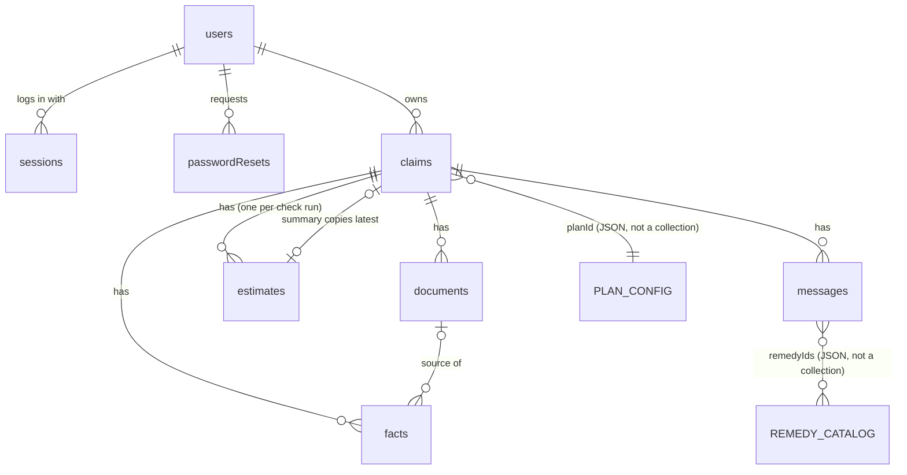

# Schemas and data model

## Facts carry their own evidence, and money never leaves integer paise

Three constraints shape the shared schemas.

First, Claude's structured outputs allow **at most 24 optional parameters and 16 `anyOf`/type-array parameters per request**. They support neither `minimum`/`maximum` nor `minLength`/`maxLength` ([structured outputs](https://platform.claude.com/docs/en/build-with-claude/structured-outputs)). The schema Claude fills is therefore a flat array of one `Fact` shape with every field required. Absence is a status (`not_found`, with `''` and `0` as sentinel values), never a null. This uses **zero** optional and **zero** union slots. A unit test walks `z.toJSONSchema()` and fails if a later edit pushes either count over its limit.

Second, enum values can come back with different capitalisation, without warning ([structured outputs](https://platform.claude.com/docs/en/build-with-claude/structured-outputs)). Keep every enum single-word lowercase, and lowercase enum fields before Zod validates them.

Third, **PHI must never appear in JSON schema definitions**, including enum values and patterns ([structured outputs](https://platform.claude.com/docs/en/build-with-claude/structured-outputs)). Never build a schema enum from user data.

Confidence is `high | medium | low` rather than a 0–1 float. The grammar cannot enforce numeric bounds, and a model's self-reported numeric confidence is not a calibrated probability.

```ts
// packages/shared/src/primitives.ts
export const ObjectIdSchema = z.string().regex(/^[a-f\d]{24}$/i);
export const IsoDateSchema  = z.iso.date();                         // 'YYYY-MM-DD': a calendar day, no time zone
export const PaiseSchema    = z.number().int().nonnegative();       // ₹1 = 100 paise; never floats
export const BpsSchema      = z.number().int().min(0).max(10_000);  // 20% = 2000 basis points

// packages/shared/src/fact.schema.ts
export const FactKey = z.enum([
  'plan_uin', 'policy_start_date', 'policy_end_date', 'first_inception_date', 'sum_insured',
  'sum_insured_used', 'age_at_entry', 'admission_date', 'discharge_date', 'diagnosis',
  'diagnosis_icd10', 'is_accident', 'ped_exists', 'ped_condition', 'ped_first_diagnosed_date',
  'ped_disclosed', 'room_category', 'room_rent_per_day', 'room_days', 'bill_total', 'bill_line_item',
]);
export const FactStatus   = z.enum(['found', 'not_found', 'illegible']);
export const FactSource   = z.enum(['document', 'user-stated', 'user-corrected']);
export const Confidence   = z.enum(['high', 'medium', 'low']);
export const QuoteCheck   = z.enum(['exact', 'fuzzy', 'none', 'unverifiable', 'not_applicable']);
export const DocumentKind = z.enum(['policy_schedule', 'policy_wording', 'discharge_summary',
                                    'hospital_bill', 'pre_auth_estimate', 'other']);
export const BillHead     = z.enum(['none', 'room', 'icu', 'nursing', 'surgeon', 'consultation', 'ot',
                                    'pharmacy', 'consumables', 'implants', 'diagnostics', 'other']);

// The schema Claude fills: all fields required, no nullables, no unions.
export const LlmFactSchema = z.object({
  key: FactKey,
  value: z.string(),          // normalised: 'YYYY-MM-DD', rupee digits '120000.50', 'true'/'false', or text
  rawValue: z.string(),       // exactly as printed
  status: FactStatus,
  sourceQuote: z.string(),    // verbatim sentence; '' unless status === 'found'
  page: z.number().int(),     // 1-based physical page index; 0 unless status === 'found'
  confidence: Confidence,
  lineItemHead: BillHead,     // 'none' unless key === 'bill_line_item'
});
export const LlmExtractionSchema = z.object({ documentKind: DocumentKind, facts: z.array(LlmFactSchema) });

// What the API stores and returns.
export const FactSchema = LlmFactSchema.omit({ lineItemHead: true }).extend({
  id: ObjectIdSchema, claimId: ObjectIdSchema, documentId: ObjectIdSchema.nullable(),
  index: z.number().int().nonnegative(),                    // 0 for single facts; position for bill lines
  lineItem: z.object({ head: BillHead, description: z.string() }).nullable(),
  source: FactSource, verification: QuoteCheck, confirmedByUser: z.boolean(),
  previousValue: z.string().nullable(), updatedAt: z.iso.datetime(),
}).superRefine((f, ctx) => {
  if (f.status !== 'found' && (f.sourceQuote !== '' || f.page !== 0))
    ctx.addIssue({ code: 'custom', message: 'not_found/illegible facts carry empty quote and page 0' });
});

// packages/shared/src/claim-facts.schema.ts: engine input; null means unknown
export const ClaimFactsSchema = z.object({
  planId: z.string(),
  policyStartDate: IsoDateSchema.nullable(), policyEndDate: IsoDateSchema.nullable(),
  firstInceptionDate: IsoDateSchema.nullable(),             // continuous cover, including porting
  sumInsuredPaise: PaiseSchema.nullable(), sumInsuredUsedPaise: PaiseSchema.nullable(),
  ageAtEntry: z.number().int().nonnegative().nullable(),
  admissionDate: IsoDateSchema.nullable(), dischargeDate: IsoDateSchema.nullable(),
  diagnosis: z.string().nullable(), icd10: z.string().nullable(), isAccident: z.boolean().nullable(),
  ped: z.object({ exists: z.boolean().nullable(), condition: z.string().nullable(),
                  firstDiagnosedDate: IsoDateSchema.nullable(), disclosed: z.boolean().nullable() }),
  room: z.object({ category: RoomCategory.nullable(), rentPerDayPaise: PaiseSchema.nullable(),
                   days: z.number().int().nonnegative().nullable() }),
  bill: z.object({ totalPaise: PaiseSchema.nullable(),
                   lineItems: z.array(z.object({ head: BillHead, amountPaise: PaiseSchema })) }),
});

// packages/shared/src/plan-config.schema.ts  (the path the kit's skills already use)
export const ClauseRefSchema = z.object({
  clauseId: z.string(),                          // as printed: '3(2)', 'Excl 02'
  page: z.number().int().positive(),
  quote: z.string().min(20),                     // verbatim from the wording
  source: z.enum(['wording', 'regulation']),     // 'regulation' only where the wording is silent
});
export const PlanConfigSchema = z.object({
  planId: z.string(), insurer: z.string(), planName: z.string(), uin: z.string(),
  wordingVersion: z.string(), rulesAsOf: IsoDateSchema, verifiedBy: z.string(),
  initialWait: z.object({ days: z.number().int(), accidentExempt: z.boolean(), clause: ClauseRefSchema }),
  specificDiseaseWait: z.object({
    months: z.number().int(), accidentExempt: z.boolean(), clause: ClauseRefSchema,
    conditions: z.array(z.object({ id: z.string(), label: z.string(),
      icd10Prefixes: z.array(z.string()), keywords: z.array(z.string()) })),
  }),
  pedWait: z.object({ months: z.number().int(), clause: ClauseRefSchema }),
  moratorium: z.object({ months: z.number().int(), clause: ClauseRefSchema }),
  roomRent: z.discriminatedUnion('kind', [
    z.object({ kind: z.literal('none'), clause: ClauseRefSchema.nullable() }),
    z.object({ kind: z.literal('pct_of_si_per_day'), bps: BpsSchema, icuBps: BpsSchema.nullable(), clause: ClauseRefSchema }),
    z.object({ kind: z.literal('fixed_per_day'), capPaise: PaiseSchema, icuCapPaise: PaiseSchema.nullable(), clause: ClauseRefSchema }),
  ]),
  proportionateDeduction: z.object({ applies: z.boolean(), excludedHeads: z.array(BillHead),
    headsVerified: z.boolean(), clause: ClauseRefSchema.nullable() }),
  coPay: z.object({ tiers: z.array(z.object({ minAgeAtEntry: z.number().int(), bps: BpsSchema })),
    clause: ClauseRefSchema.nullable() }),
  sumInsured: z.object({ optionsPaise: z.array(PaiseSchema), clause: ClauseRefSchema }),
});

// packages/shared/src/rule-result.schema.ts
export const RuleId      = z.enum(['R1', 'R2', 'R3', 'R4', 'R5', 'R6', 'R7', 'R8']);
export const RuleOutcome = z.enum(['pass', 'deduction', 'fail', 'unknown']);
export const RuleResultSchema = z.object({
  ruleId: RuleId, outcome: RuleOutcome, applicable: z.boolean(),
  reasonCode: z.string(),                        // 'R2_WITHIN_INITIAL_WAIT', 'R6_ROOM_OVER_CAP', …
  deductionPaise: PaiseSchema,                   // > 0 only when outcome === 'deduction'
  clause: ClauseRefSchema.nullable(),
  usedFacts: z.array(FactKey),
  missingFacts: z.array(FactKey),                // non-empty if and only if outcome === 'unknown'
  params: z.record(z.string(), z.union([z.string(), z.number()])),   // values for explanation templates
});
export const Verdict = z.enum(['likely_payable', 'likely_partial', 'at_risk']);
export const EstimateSchema = z.object({
  verdict: Verdict,
  claimedPaise: PaiseSchema,
  payablePaise: PaiseSchema,                     // 0 when any eligibility rule fails
  payableIfEligiblePaise: PaiseSchema,           // the R6–R8 result assuming R1–R5 pass
  outOfPocketPaise: PaiseSchema,
  waterfall: z.array(z.object({ ruleId: RuleId, beforePaise: PaiseSchema, afterPaise: PaiseSchema })),
  results: z.array(RuleResultSchema).length(8),
  planId: z.string(), wordingVersion: z.string(), rulesAsOf: IsoDateSchema,
  engineVersion: z.string(), factsVersion: z.number().int(),
});
```

Four rules turn these schemas into behaviour. Write each into `docs/rules-spec.md` before coding.

**Usability.** `toClaimFacts(facts)`, a pure function in `rules`, uses a fact only if one of these holds:

- it is a `found` fact whose quote verified (`exact` or `fuzzy`) and whose confidence is not `low`;
- the user confirmed it;
- its source is `user-stated` or `user-corrected`.

Every other fact becomes `null`, so the rule that needs it returns `unknown`. The kit's "never guessed" rule then holds by construction.

**Evaluation order.** Eligibility comes first:

- R1 policy active;
- R2 30-day wait, accident-exempt;
- R3 specific-disease wait;
- R4 PED wait;
- R5 the 60-month moratorium, which removes R4's non-disclosure risk once cover has run 60 continuous months.

Then the payable waterfall: R6 room rent with proportionate deduction on non-excluded heads, then R7 co-pay, then R8 the sum-insured cap. This is why the amount rules need a third parameter, `(facts, plan, runningPaise) => RuleResult`.

**Rounding.** Proportionate deduction pays `floor(amount × cap ÷ actualRent)` for each associated head, and co-pay uses basis points. State the rounding direction once in the spec and give it its own test rows.

**Verdict (a proposal; pin it before writing `TC-ENG` tests):**

- `at_risk` if any of R1–R5 is `fail` or `unknown`;
- `likely_partial` if eligible and payable is below claimed, or any of R6–R8 is `unknown`;
- `likely_payable` only when the full claimed amount is payable.

Two values come from the hackathon's earlier policy research and must stay in config, not code. The moratorium is **60 months** under IRDAI's May 2024 master circular ([The Week](https://www.theweek.in/news/india/2024/05/30/irdai-issues-new-master-circular-to-make-health-insurance-claims-process-more-seamless.amp.html)). The bill heads excluded from proportionate deduction are **unverified** against the circular, which is why `headsVerified` exists and is shown on screen.

## MongoDB collections (v2: email login, history, two-tier retention)

### Relationships



| From → To | Cardinality | Stored as | Notes |
|---|---|---|---|
| users → sessions | 1 → many | `sessions.userId` | One per device; all deleted on password reset |
| users → passwordResets | 1 → many | `passwordResets.userId` | Expire after 30 min |
| users → claims | 1 → many | `claims.userId` | The ownership root: every claim query filters on it |
| claims → documents, facts, estimates, messages | 1 → many | `claimId` **and** `userId` on every child | `userId` is repeated so children are scoped without a join |
| documents → facts | 1 → many, optional | `facts.documentId` (null for user-stated facts) | Where a fact's quote came from |
| claims → latest estimate | 1 → 0..1 | `claims.summary` (embedded copy) + `summary.estimateId` | Embedded so history needs no join; the copy outlives the estimate row |
| claims → plan config | many → 1 | `claims.planId` + `wordingVersion` | Versioned JSON in `packages/rules/config/` |
| messages → remedy catalog | many → many | `messages.remedyIds[]` | JSON catalog, not a collection |

Every relationship is a stored ID that the service resolves; there is no `populate()`. Children carry the claim's expiry dates and are deleted by their own TTL, not by a cascade.

### What changed from v1

| v1 | v2 | Why |
|---|---|---|
| Google sign-in; `users` stores no email | Email + password; `users` stores email and an argon2id hash | Login and sign-up screens (06, 07) |
| Next.js mints a 5-minute JWT | API owns sessions: opaque token, SHA-256 hash stored in `sessions` | Revocable on logout and password reset; no shared JWT secret |
| Files kept 24 h; the whole claim expires at 30 days | Two tiers: **detail** (files, facts, estimates, chat) expires at 7 or 30 days; the **summary** row stays for 180 days | History screen (08) must outlive the files without keeping medical facts |
| History needs a join | `claims.summary` is a denormalised copy of the latest estimate | One indexed query renders the history table |

### Retention model

Everything about a claim falls into one of two tiers.

| Tier | What | Standard (default) | Extended (user ticked "Keep my claim for 30 days") | Guest / sample |
|---|---|---|---|---|
| **Detail** | Blobs, `documents`, `facts`, `estimates`, `messages` | 7 days | 30 days | 24 h |
| **Summary** | The `claims` row: relation, treatment, plan, verdict, amounts, each check's outcome and clause ID | 180 days | 180 days | 24 h |

- The summary keeps **no document text, quotes, diagnosis, dates or bill lines**. It keeps what the History screen shows and what a returning user needs to decide on "Check again".
- `treatment` is still health data. It stays because the user typed it to label their own claim, and it disappears with the summary at 180 days or on "Remove from history".
- All durations are config: `DETAIL_TTL_DAYS_STANDARD=7`, `DETAIL_TTL_DAYS_EXTENDED=30`, `SUMMARY_TTL_DAYS=180`, `GUEST_TTL_HOURS=24`.
- **Open decision:** 180 days is a proposal. A shorter period is easier to defend under DPDP purpose limitation.

The API decides what "Open" shows, using the server clock and never by checking whether child rows still exist (the TTL monitor can lag):

```ts
const view = now < claim.detailExpiresAt ? 'full' : 'summary';
const rulesChanged = claim.summary !== null && claim.summary.rulesAsOf !== plan.rulesAsOf;
```

### Collections at a glance

| Collection | Owner key | Expires (`expiresAt`, TTL) | Holds health data |
|---|---|---|---|
| `users` | itself | Guests only: 24 h | No |
| `sessions` | `userId` | 7 days, sliding | No |
| `passwordResets` | `userId` | 30 minutes | No |
| `claims` | `userId` | Summary expiry (180 days) | Treatment label only |
| `documents` | `userId` | Detail expiry | Metadata only; files in Azure Blob |
| `facts` | `userId` | Detail expiry | **Yes** |
| `estimates` | `userId` | Detail expiry | Yes (params) |
| `messages` | `userId` | Detail expiry | **Yes** |

Plans and the remedy catalog are **not** collections. They are versioned JSON in `packages/rules/config/`, reviewed in PRs, and loaded at boot.

The general rules still hold:

- Every owned collection carries `userId`, which is first in every compound index.
- Every query goes through `ScopedRepository` plus the `requireUserScope` plugin.
- TTL indexes are single-field `{ expiresAt: 1 }` with `expireAfterSeconds: 0`.
- Money is integer paise and calendar dates are `YYYY-MM-DD` strings. `Date` is used only for instants: `createdAt`, `expiresAt`, `at`.

### `users`

```ts
{
  _id: ObjectId,
  kind: 'password' | 'guest',
  email: string | undefined,           // lowercased + trimmed; absent for guests
  passwordHash: string | undefined,    // argon2id PHC string; absent for guests
  displayName: string | undefined,     // optional; shown in the top bar only
  adultAttestedAt: Date | undefined,   // sign-up checkbox
  termsVersion: string | undefined,    // 'terms-v1'
  failedLogins: number,                // reset to 0 on success
  lockedUntil: Date | null,            // 15 min after 5 failures in a row
  passwordChangedAt: Date | undefined,
  expiresAt: Date | undefined,         // guests: now + 24 h; registered users: absent, so never expires
  createdAt: Date, updatedAt: Date,
}
```

| Index | Purpose |
|---|---|
| `{ email: 1 }` unique, `partialFilterExpression: { email: { $type: 'string' } }` | One account per email; guests (no email) don't collide |
| `{ expiresAt: 1 }`, `expireAfterSeconds: 0` | Guest cleanup. Registered users have no field, so TTL skips them. |

- **Password hashing:** argon2id with OWASP's minimum parameters (m = 19 MiB, t = 2, p = 1), via `@node-rs/argon2`, which ships prebuilt binaries. Check the current version and the pnpm minimum package age before installing.
- **No account enumeration:** login returns the same `401 AUTH_INVALID` for an unknown email and a wrong password. Sign-up with a taken email returns `409 EMAIL_TAKEN`; that small leak is accepted for an MVP. Note it in `docs/compliance.md`.
- The `requireUserScope` plugin is **not** applied here, since `users` is looked up by email at login.

### `sessions`

```ts
{ _id, userId, tokenHash: string /* sha256(base64url token) */, expiresAt: Date, lastSeenAt: Date, createdAt }
```

| Index | Purpose |
|---|---|
| `{ tokenHash: 1 }` unique | Guard lookup on every request |
| `{ userId: 1 }` | Log out everywhere; revoke all sessions on password reset |
| `{ expiresAt: 1 }` TTL | Expiry |

- The raw token (32 random bytes) is returned once, at login. Next.js stores it in an httpOnly, `Secure`, `SameSite=Lax` cookie and forwards it as `Bearer`. A database leak exposes only hashes.
- **Sliding expiry:** when less than half of the 7 days is left, the guard pushes `expiresAt` forward. Write at most once an hour, using `lastSeenAt`.

### `passwordResets` (only if "Forgot password?" ships)

```ts
{ _id, userId, tokenHash: string, expiresAt: Date /* +30 min */, usedAt: Date | null, createdAt }
```

| Index | Purpose |
|---|---|
| `{ tokenHash: 1 }` unique | Look up the token from the reset link |
| `{ expiresAt: 1 }` TTL | Expiry |

- This needs an email provider, which isn't in the stack yet. If time is short, hide the link on screen 06 and log the decision in `AI_LOG.md` / an ADR.

### `claims`

```ts
{
  _id: ObjectId,
  userId: ObjectId,
  isSample: boolean,
  sampleCaseId: 'A' | 'B' | 'B2' | 'C' | 'D' | null,

  planId: string,                      // 'star-fho'
  wordingVersion: string,              // 'V.19/2023'
  subject: {                           // set-up screen (02); shown in history
    relation: 'self' | 'parent' | 'spouse' | 'child' | 'other',
    treatment: string,                 // max 80 chars, user-typed label
  },
  status: 'draft' | 'extracted' | 'checked',
  factsVersion: number,                // +1 on every fact change; estimateStale = estimate.factsVersion < this

  consent: {
    version: 'consent-v1',
    analysis: true,                    // required
    retention: 'standard' | 'extended',
    improve: boolean,                  // "Help improve ClaimSense"
    at: Date,
  },

  summary: null | {                    // copy of the latest estimate; written on every POST /check
    estimateId: ObjectId,
    verdict: 'likely_payable' | 'likely_partial' | 'at_risk',
    claimedPaise: number,
    payablePaise: number,
    outOfPocketPaise: number,
    checks: Array<{                    // always 8, R1..R8
      ruleId: RuleId,
      outcome: 'pass' | 'deduction' | 'fail' | 'unknown',
      reasonCode: string,              // 'R3_WITHIN_SPECIFIC_WAIT'
      clauseId: string | null,         // '3(2)', ID only, no quote text
      deductionPaise: number,
      unlocksOn: string | null,        // 'YYYY-MM-DD' when a wait ends (R2–R4), else null
    }>,
    rulesAsOf: string,                 // compare with the plan config for the "Rules updated" banner
    engineVersion: string,
    checkedAt: Date,
  },

  detailExpiresAt: Date,               // createdAt + 7d / 30d / 24h
  blobExpiresAt: Date,                 // detailExpiresAt − 1 h (blobs always go before their rows)
  expiresAt: Date,                     // summary expiry: createdAt + 180d (24h for guest/sample) → TTL
  createdAt: Date, updatedAt: Date,
}
```

| Index | Serves |
|---|---|
| `{ userId: 1, createdAt: -1 }` | History list, newest first (screen 08, "All" tab) |
| `{ userId: 1, 'summary.verdict': 1, createdAt: -1 }` | History filter tabs |
| `{ expiresAt: 1 }` TTL | Summary expiry |

- **Search box:** a case-insensitive regex on `subject.treatment` inside `{ userId }`. One user has a handful of rows, so a text index isn't worth it. Escape the regex input.
- **Summary tiles:** computed in the service from the same list query (last 30 days). No aggregation pipeline is needed.
- `unlocksOn` lets the summary view say "the 24-month wait ends Mar 2027" after the facts are gone. It is a date, not a diagnosis.

### `documents` (model `ClaimDocument`)

These fields are unchanged from v1:

- `userId`, `claimId`, `kind`, `blobName` (`${userId}/${claimId}/${uuid}`), `mime`, `sizeBytes`, `sha256`, `pages`, `textLayer`
- `extraction` (`pending` | `done` | `failed`), `errorCode`, `blobDeletedAt`
- **No original file name.**

New: `blobExpiresAt` and `expiresAt` are **copied from the claim** at upload, so every document of a claim dies together.

| Index | Purpose |
|---|---|
| `{ userId: 1, claimId: 1, createdAt: -1 }` | Documents for a claim |
| `{ blobExpiresAt: 1, blobDeletedAt: 1 }` | Sweeper scan (not TTL) |
| `{ expiresAt: 1 }` TTL | Row expiry |

### `facts`

- `FactSchema` fields plus `userId` and `expiresAt` (copied from `claim.detailExpiresAt`).
- Unique `{ userId: 1, claimId: 1, key: 1, index: 1 }`; TTL `{ expiresAt: 1 }`.
- Corrections update in place (`previousValue` keeps one step of undo) and bump `claims.factsVersion` in the same `bulkWrite`.

### `estimates`

- `EstimateSchema` fields plus `userId`, `claimId`, `expiresAt` (detail).
- Every `POST /check` inserts a new row, so a re-run never overwrites the saved result. It then overwrites `claims.summary` from it.
- `{ userId: 1, claimId: 1, createdAt: -1 }`; TTL `{ expiresAt: 1 }`.
- What-if runs (`/simulate`, chat) are **not** saved here. They are recomputed, or embedded in the chat message that showed them.

### `messages`

```ts
{ _id, userId, claimId, role: 'user' | 'assistant', text: string,
  intent: string | null, remedyIds: string[],
  whatIf: SimulationResult | null,     // snapshot of what the card showed
  expiresAt: Date, createdAt: Date }
```

- `{ userId: 1, claimId: 1, createdAt: 1 }`; TTL `{ expiresAt: 1 }`.
- `text` is never logged (pino redaction covers `text`, `value`, `rawValue`, `sourceQuote`).

### Example: Case B claim after its files expired

```json
{
  "_id": "6718c0de9a1b2c3d4e5f6071",
  "userId": "6718c0aa9a1b2c3d4e5f6001",
  "isSample": false, "sampleCaseId": null,
  "planId": "star-fho", "wordingVersion": "V.19/2023",
  "subject": { "relation": "parent", "treatment": "Knee replacement" },
  "status": "checked", "factsVersion": 3,
  "consent": { "version": "consent-v1", "analysis": true, "retention": "standard", "improve": false, "at": "2026-10-25T05:02:11Z" },
  "summary": {
    "estimateId": "6718c1f09a1b2c3d4e5f60a2",
    "verdict": "likely_partial",
    "claimedPaise": 24000000, "payablePaise": 20580000, "outOfPocketPaise": 3420000,
    "checks": [
      { "ruleId": "R1", "outcome": "pass", "reasonCode": "R1_ACTIVE", "clauseId": null, "deductionPaise": 0, "unlocksOn": null },
      { "ruleId": "R6", "outcome": "deduction", "reasonCode": "R6_ROOM_OVER_CAP", "clauseId": "2(A)", "deductionPaise": 2460000, "unlocksOn": null }
    ],
    "rulesAsOf": "2026-10-25", "engineVersion": "1.0.0", "checkedAt": "2026-10-25T05:09:40Z"
  },
  "detailExpiresAt": "2026-11-01T05:02:11Z",
  "blobExpiresAt": "2026-11-01T04:02:11Z",
  "expiresAt": "2027-04-23T05:02:11Z",
  "createdAt": "2026-10-25T05:02:11Z", "updatedAt": "2026-10-25T05:09:40Z"
}
```

(`checks` is shortened here; the real row always has eight entries.)

### Mongoose definition, `claims` (pattern for the rest)

```ts
// apps/api/src/claims/claim.schema.ts
@Schema({ collection: 'claims', timestamps: true, versionKey: false })
export class Claim {
  @Prop({ type: Types.ObjectId, required: true }) userId!: Types.ObjectId;
  @Prop({ required: true }) isSample!: boolean;
  @Prop({ type: String, enum: ['A', 'B', 'B2', 'C', 'D'], default: null }) sampleCaseId!: string | null;
  @Prop({ required: true }) planId!: string;
  @Prop({ required: true }) wordingVersion!: string;
  @Prop({ type: SubjectSchema, required: true }) subject!: Subject;
  @Prop({ type: String, enum: ['draft', 'extracted', 'checked'], default: 'draft' }) status!: string;
  @Prop({ default: 0 }) factsVersion!: number;
  @Prop({ type: ConsentSchema, required: true }) consent!: Consent;
  @Prop({ type: ClaimSummarySchema, default: null }) summary!: ClaimSummary | null;
  @Prop({ required: true }) detailExpiresAt!: Date;
  @Prop({ required: true }) blobExpiresAt!: Date;
  @Prop({ required: true }) expiresAt!: Date;
}
export const ClaimSchema = SchemaFactory.createForClass(Claim);
ClaimSchema.index({ userId: 1, createdAt: -1 });
ClaimSchema.index({ userId: 1, 'summary.verdict': 1, createdAt: -1 });
ClaimSchema.index({ expiresAt: 1 }, { expireAfterSeconds: 0 });
ClaimSchema.plugin(requireUserScope);
```

- Keep `autoIndex: true` in tests and dev only.
- In production, run `syncIndexes()` from a one-off script.
- One test asserts that each model's `schema.indexes()` matches the tables above, so an index can't silently disappear.

### Deletion and the sweeper

`RetentionSweeper` runs every 10 minutes. Times come from `Clock`; tests use `FixedClock`.

1. **Blobs:** find `documents` with `blobExpiresAt <= now` and `blobDeletedAt: null`, delete each blob, then set `blobDeletedAt`.
   - Idempotent: a blob that is already gone counts as deleted.
   - The query is a cross-user maintenance job, so it uses an explicit `{ $comment: 'retention-sweeper' }` bypass. That bypass is the **only** exception the `requireUserScope` plugin allows, and it has a test.
2. **Rows:** left to TTL. Child rows carry the claim's `detailExpiresAt` as their own `expiresAt`, so no cascade is needed.

User-triggered deletes run synchronously, always blobs first. If storage fails, the endpoint returns `503 STORAGE_UNAVAILABLE` and deletes nothing.

| Action | Deletes |
|---|---|
| `DELETE /claims/:id` ("Delete my data" on 04/05, "Remove from history" on 09) | Blobs → documents, facts, estimates, messages → claim |
| `DELETE /me` ("Delete all my data" on 08) | Every blob under `${userId}/` → all owned rows → sessions → user |
| Log out | That session |
| Password reset | All of that user's sessions + the reset row |

A deleted claim returns the **same 404** as one that never existed. There are no tombstones, so `410` is not used.

### Changes this makes to `04-api.md`

New public routes, rate-limited per email and per user (the throttler key falls back to email when there is no user yet):

- `POST /auth/signup` `{ email, password, displayName?, adultAttested: true, termsVersion }` → 201 `{ token, user }`; 409 `EMAIL_TAKEN`
- `POST /auth/login` `{ email, password }` → 200 `{ token, user }`; 401 `AUTH_INVALID`; 423 `ACCOUNT_LOCKED`
- `POST /auth/logout` → 204

New authenticated routes:

- `GET /claims?verdict=&q=&cursor=` → 200 `{ claims: ClaimListItem[], stats, nextCursor }`
- `DELETE /me` → 204

Changes to existing routes:

- `GET /claims/:id` now returns `{ view: 'full', ...ClaimDetail, rulesChanged }` or `{ view: 'summary', claim: ClaimSummary, rulesChanged, detailExpiredAt }`.
- In summary view, every detail route (`/documents`, `/extract`, `/facts`, `/check`, `/simulate`, `/remedies`, `/messages`) returns `409 DETAIL_EXPIRED`.
- `CreateClaimRequest`: `consent.storeDocuments` is replaced by `consent.retention: 'standard' | 'extended'`, and gains `subject` and `consent.improve`.
- `AuthGuard`: verifies the opaque session token against `sessions` instead of a JWT.
- Guests still get a session, created by `POST /sample/:caseId` when there is no cookie.
- Remove the `jose` dependency and `WEB_JWT_SECRET`.

New error codes: `EMAIL_TAKEN` (409), `ACCOUNT_LOCKED` (423), `DETAIL_EXPIRED` (409).
